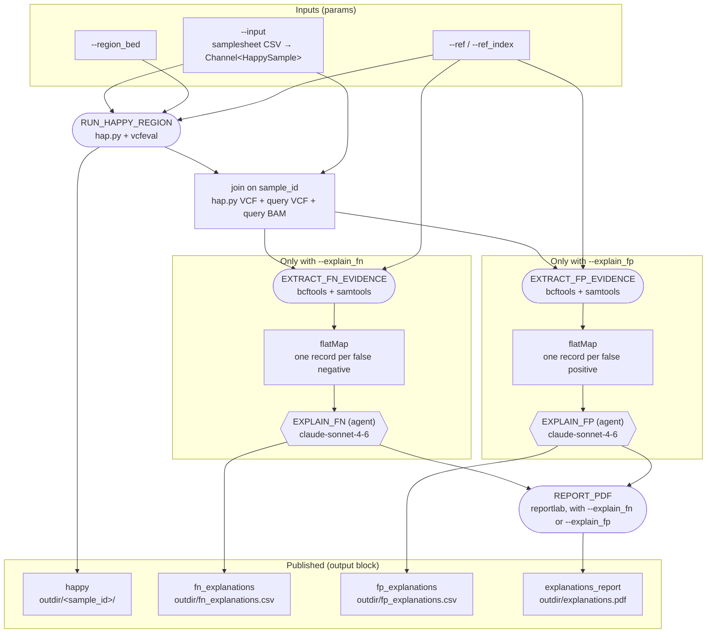
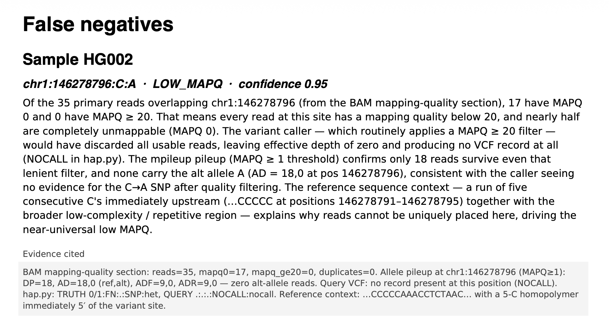
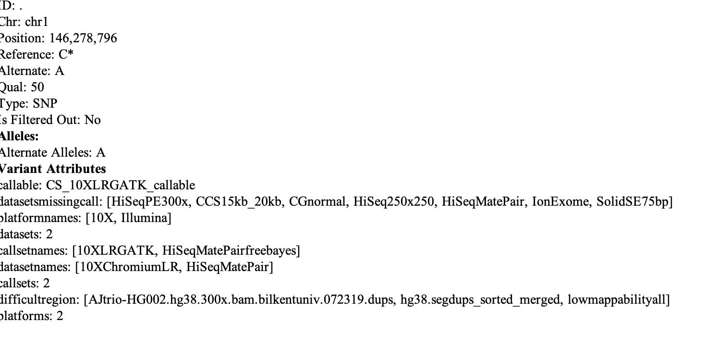

This past summer I worked on an analytical validation of a polygenic risk score LDT for a client. Part of the work was downsampling GIAB trio WGS data and using [hap.py](https://github.com/Illumina/hap.py) to measure precision and recall against the GIAB high-confidence truth set at different coverages.

One  tedious part was investigating false negatives, variants that should have been called but weren't. Each one meant reading VCF records and inspecting BAM pileups by hand.

[Seqera](https://seqera.io/) recently added [agent primitives](https://docs.seqera.io/nextflow/agent) to Nextflow, which let a pipeline run agentic tasks (see their [blog post](https://seqera.io/blog/agentic-nextflow/)). After working through the [agent examples](https://github.com/nextflow-io/nextflow/tree/master/examples/agents), I added a step to my [nextflow-run-happy-region](https://github.com/indapa/nextflow-run-happy-region) pipeline that explains the false negatives and false positives in hap.py results:

For false negatives, the agentic part runs in two steps:

1. **`EXTRACT_FN_EVIDENCE`** (a regular process) randomly samples, with a fixed seed, up to `--max_fn` truth variants that hap.py marked `BD=FN`. For each one it writes a text file containing:
   - hap.py and query VCF records (all FILTER values) within `--fn_window` bp
   - the reference sequence
   - read evidence from the query BAM: depth, read counts by mapping quality, and a per-allele pileup split by strand

   The BAM matters because most false negatives have no record in the query VCF, so there are usually no `AD` or `DP` values to look at.
2. **`EXPLAIN_FN`** (an agent running `anthropic/claude-sonnet-4-6`, with no tools) reads one evidence file per task and returns a structured record.

False positives follow the same pattern. The results are written to a CSV file and a PDF report.

## Example false negative explanation

Here is one explanation from benchmarking a DeepVariant HG002 callset against the HG002 high-confidence regions:

In IGV, every read carrying the alternate A allele has a MAPQ of 0, which is why they're drawn in white. DeepVariant ignores these reads, since its default `--min_mapping_quality` is 5.

The truth VCF annotations explain the zero MAPQ: the variant sits in a low-mappability region and a segmental duplication.

The IGV evidence supports Claude's explanation of why this variant was missed.

## Try it yourself

False negative and false positive explanations are both available in [nextflow-run-happy-region](https://github.com/indapa/nextflow-run-happy-region). Give it a try in your next short-variant benchmarking experiment.
